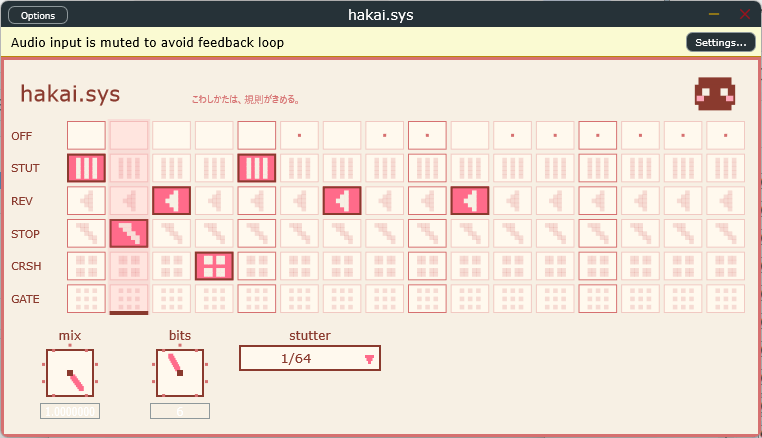

# hakai.sys

こわしかたも、規則がきめる。

ビートを16ステップでこわすエフェクト。1小節を16に割って、それぞれのステップに
**off / stutter / reverse / tapestop / crush / gate** のどれかを置きます。
つまみは「Mix」「Stutter Div（1/32・1/64・1/128）」「Crush Bits（2〜12）」。
VST3 と Windows スタンドアロン。配布パッケージは [BOOTH](https://vicugna.booth.pm/items/9031203) にあります（0円）。

> これはオーディオプラグインです。Windows のシステムファイルではありません。



## ビルド

```
git clone https://github.com/juce-framework/JUCE ../JUCE
cmake -S . -B build
cmake --build build --config Release
```

JUCE をこのリポジトリの**隣**（`../JUCE`）に置いてください。
フォントは DotGothic16（OFL、同梱）。

## DAW からの使い方

Ableton Live などで、こわしたいトラックに挿すだけです。初期値は全ステップ off なので、
ステップを置くまで素通しです。オートメーションや外部制御（AbletonMCP の
`set_device_parameter` など）からは、Step 1〜16 に 0〜5 の番号÷5 の値を書きます。

## ライセンス

GPLv3。詳細は [LICENSE](LICENSE) と [THIRD_PARTY.txt](THIRD_PARTY.txt)。

---

ひゅーまん / ω （vicugna） — 規則の部屋: https://hyu-man.com/
不具合・質問: omega@hyu-man.com
